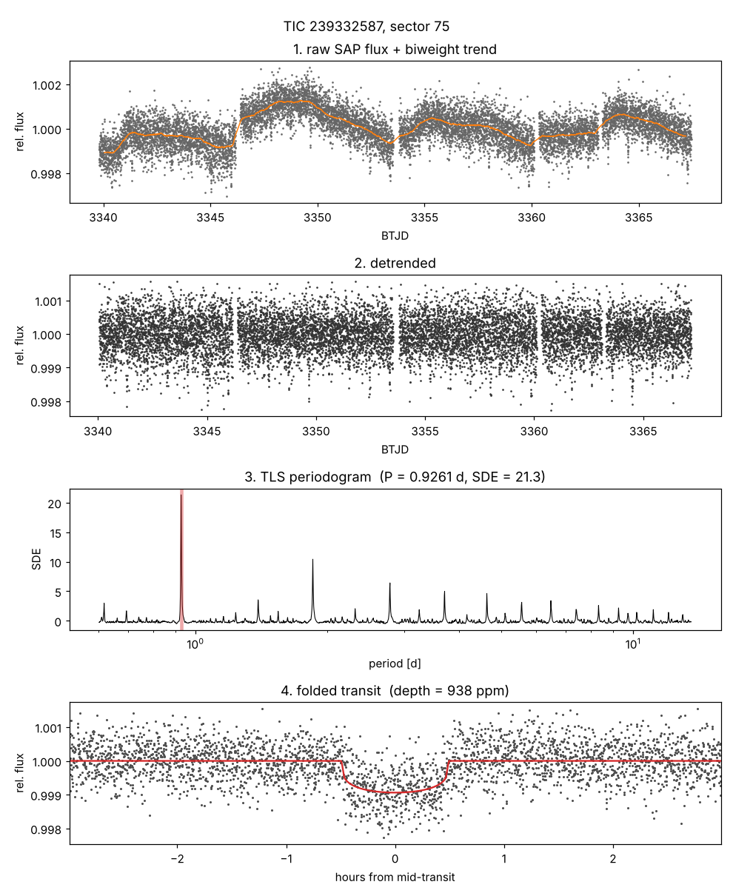

# exoplanet-hunt

An end-to-end transit search on NASA TESS light curves, written from scratch:
ingest, detrend, search, vet, classify. The goal is a pipeline whose accuracy is
**measured** (injection-recovery, known-planet recall, false-positive rate), then
pointed at sectors and stars that have had few independent searches.

Anything this pipeline flags is a *candidate*. Confirmation needs follow-up
observations by others.

## Status: week 2 (measure it)

Week 2 answers "how good is this pipeline, and why does it miss what it misses?"
with injection-recovery, recall on every known TOI in the sector, a
false-alarm rate, and a from-scratch BLS search with a CUDA kernel.

**Headline:** the pipeline is at the noise limit. It recovers **93% of injected
planets whose transits have an expected SNR ≥ 12** (50% at SNR ≈ 9.5), known
TOIs follow the same curve, and the shallow-planet misses from week 1 are
signals too faint for one sector of QLP data, not signals the pipeline throws away.

### Injection-recovery

5,000 synthetic planets planted in the **raw** QLP flux of 500 sector-75 stars
that host no TOI (T ≤ 13.5, R★ < 2.5 R☉, drawn from three RA strips; median
T = 12.7), then run through the full pipeline: detrend, TLS (2 signals/star),
cross-match. Transits are limb-darkened batman models integrated over the 200 s
exposure, with P log-uniform in 0.6 to 13.5 d, R_p log-uniform in 0.5 to 16 R⊕,
b uniform in 0 to 0.9, and each star's TIC radius and mass. "Recovered" means
SDE ≥ 9 and a period (or simple alias) and epoch match.


The radius map reflects these fairly faint field stars (a 2 R⊕ planet is
~350 ppm on a Sun-like star; one 200 s point at T = 12.7 scatters by ~5,000 ppm).
The number that transfers to any star is recall against **expected SNR**
(injected depth × √(in-transit points) / point scatter):


| expected SNR | 5–7 | 7–9 | 9–12 | 12–16 | 16–25 | 25–50 | > 50 |
|---|---|---|---|---|---|---|---|
| injections, TLS | 6% | 36% | 65% | 80% | 92% | 96% | 98% |
| known TOIs, TLS | 4% | 20% | 40% | 57% | 88% | 100% | 97% |

The TOI curve lags at SNR 9 to 16 because of long periods, not depth: of the 12
known TOIs with SNR ≥ 12 that were missed, 6 have P > 13.5 d, which the
periodic search (≥ 2 transits, P ≤ baseline/2) never tries, and one is the
strong-TTV system TOI-1136.01. Restricted to
P ≤ 13.5 d, known-TOI recall at SNR ≥ 12 is **91.5%** against 93% for
injections, which is a good check that the injections are realistic.

Tables: [`results/s0075/injections/`](results/s0075/injections/) (one row per
injection, with `snr_expected` and `depth_retained`), [`recall_vs_snr.csv`](results/s0075/recall_vs_snr.csv),
[`toi_expected_snr.csv`](results/s0075/toi_expected_snr.csv).

### Why the shallow planets were missed

* **Noise, mostly.** 87 of the 181 known TOIs with ≥ 2 transits in sector 75
  have an expected SNR below 9 in its QLP light curve; recall there is 7%,
  in line with the injections (0 to 36%). These need more sectors stacked
  (or 2-min SPOC data), not a different search.
* **Detrending eats a little, and only for long transits.** Depth kept after
  the 0.75 d biweight: 99% for transits under 2.5 h, 86% at 3.5 to 5 h, 75% at
  5 to 7 h, 60% above 7 h. Paired tests on the same 1,500 injections:

  | variant | recall | SNR 7–12 | SNR ≥ 12 | SNR ≥ 12, > 4 h | depth kept, > 4 h |
  |---|---|---|---|---|---|
  | biweight 0.5 d | 25.2% | 39% | 95% | 87% | 67% |
  | **biweight 0.75 d (default)** | **25.8%** | **47%** | **95%** | **87%** | 82% |
  | biweight 1.0 d | 25.1% | 45% | 93% | 79% | 89% |
  | biweight 1.5 d | 24.4% | 39% | 92% | 79% | 94% |
  | 0.75 d on QLP `SYS_RM_FLUX` | 24.9% | 42% | 94% | 83% | 80% |

  Longer windows keep more of a long dip but let more stellar variability
  through, which costs more than it gains. 0.75 d on raw SAP flux stays the default.
* **Long periods.** Allowing P up to the full baseline (one transit minimum in
  the grid) gained 1 TOI and lost 2 (lone dips outranked real signals), and a
  separate long-period pass on the masked light curve gained none. Long periods
  and single transits go to the dedicated single-event detector in week 3.
* **Data gaps.** 36 of the 79 high-SNR injection misses had only one transit
  in good data; no periodic search can get those.

### Recall on all known TOIs in sector 75

Every ExoFOP TOI in the sector, no magnitude cut (QLP has light curves for 298
of the 313 host stars). Over TOIs with ≥ 2 transits in the data:

| set | n | recovered (SDE ≥ 9) | recall |
|---|---|---|---|
| CP / KP / PC / APC, T ≤ 13.5 (week 1 sample) | 173 | 76 | 44% |
| CP / KP / PC / APC, all T | 181 | 79 | 44% |
| FP (known false positives) | 62 | 42 | 68% |

The pipeline also "finds" two thirds of the known false positives, mostly
eclipsing binaries with deep, easy dips. Telling those apart is the vetting and
classifier stages' job, and these 42 are a ready-made test set for them.

### False-alarm rate

Searching the same 500 field stars *without* injections, 2.8% get a top signal
with TLS SDE ≥ 9. Some of these are real (variables, eclipsing binaries,
perhaps planets), so this is an upper bound on the false-alarm rate.

### Own BLS search, CPU and CUDA

[`search/bls.py`](src/exohunt/search/bls.py) is a Box Least Squares written from
scratch: fold into phase bins, prefix-sum, score every box of 0.5 to 8 h with
Δχ² = s² / (r (1 − r)), SDE from the detrended periodogram, on the same Ofir
period grid TLS uses. It has two backends running the identical algorithm:

* **CPU:** numba, parallel over trial periods.
* **CUDA:** one thread block per (period, star). The block bins the star's
  points into shared memory with atomics, prefix-sums the bins cooperatively,
  each thread scores a slice of start phases, and a block reduction keeps the
  best box. Hundreds of stars go into a single launch.

**Accuracy at the same false-alarm rate** (BLS SDE ≥ 6.0 flags 2.2% of
un-injected stars vs 2.8% for TLS SDE ≥ 9), on the same 5,000 injections:
BLS recovers **26.2%** vs TLS **26.0%**: slightly better at SNR 5 to 9,
slightly worse above 12. TLS's limb-darkened template helps on strong signals,
the box costs little.

**Speed** (227 TOI hosts, median 11,205 points, 2,479 trial periods, search only):

| backend | hardware | stars / s |
|---|---|---|
| TLS (reference) | 4 CPU cores | 5.9 |
| own BLS, numba | 4 CPU cores | 23.7 (4.0×) |
| own BLS, CUDA | NVIDIA GPU | *not measured yet: no GPU in the dev environment* |

The CUDA kernel is tested against the CPU path in numba's CUDA simulator
(periodograms agree to < 10⁻⁴ relative, float32 vs float64), but a simulator
says nothing about speed. To benchmark it on a machine with an NVIDIA GPU:

```bash
pip install -e .[dev,gpu]                 # adds numba-cuda (CUDA 12)
exohunt ingest --sector 75                # ~155 MB
EXOHUNT_REAL_CUDA=1 pytest tests/test_bls.py   # kernel vs CPU on the real device
exohunt bench --sector 75 --n 227 --tag gpu    # TLS vs BLS CPU vs BLS CUDA -> results/s0075/benchmark_gpu.csv
```

## Week 1: rediscover known planets

Sector 75 (2024), QLP full-frame-image light curves, every ExoFOP TOI host with
TFOPWG disposition CP / KP / PC / APC and T ≤ 13.5: **250 TOIs on 227 stars**.

| step | what it does |
|---|---|
| ingest | QLP `SAP_FLUX` from MAST; drop cadences with `QUALITY != 0`; normalise |
| detrend | wotan sliding biweight, 0.75 d window; clip upward outliers only |
| search | Transit Least Squares, P = 0.6 d to baseline/2, up to 2 signals per star (mask and repeat) |
| cross-match | detected period vs TOI period (incl. 1/2, 2, 1/3, 3, 3/2, 2/3 aliases), TOI ephemeris propagated to our epoch |

**Runtime:** about 75 s for all 227 stars on 4 CPU cores (≈0.3 s per star-signal).

### Recall on known TOIs (week 1)

Only TOIs with **at least 2 transits inside the sector's good data** can be found by
a periodic search, so recall is computed over those 173 (the other 77 have 0 or 1
transit in this sector; that is the single-event detector's job in week 3).

| TFOPWG disposition | n | recovered, SDE ≥ 9 | recall | recovered, SDE ≥ 7 | recall |
|---|---|---|---|---|---|
| CP (confirmed) | 33 | 14 | 42% | 17 | 52% |
| KP (known planet) | 17 | 9 | 53% | 9 | 53% |
| APC | 18 | 15 | 83% | 15 | 83% |
| PC | 105 | 38 | 36% | 44 | 42% |
| **all** | **173** | **76** | **44%** | **85** | **49%** |

"Recovered" = exact period match or a simple alias, with transits landing on the
TOI ephemeris. One more (TOI-1136.01, a strong-TTV system) matches in period but
its transits are offset by ~6 h from the linear ephemeris, so it is not counted.

Recall by TOI depth (SDE ≥ 9):

| depth | n | recall |
|---|---|---|
| < 500 ppm | 25 | 8% |
| 500 – 1000 ppm | 32 | 28% |
| 1000 – 3000 ppm | 49 | 37% |
| > 3000 ppm | 67 | 70% |

Smallest planets recovered: TOI-4481.01 (1.7 R⊕, 950 ppm, P = 0.93 d),
TOI-1430.01 (2.0 R⊕, 700 ppm, P = 7.43 d), TOI-1339.01 (3.2 R⊕, P = 8.88 d).

Full tables: [`results/s0075/`](results/s0075/) (`detections.csv`, `recovery_sde9.csv`, `recall_summary_sde9.csv`).



### What week 1 taught

* **QLP v02 files** (later sectors) rename `KSPSAP_FLUX` to `DET_FLUX`; the reader handles both.
* **Data gaps create 3/2 aliases.** TOI-1148.01 (P = 5.55 d) shows only two transits
  16.65 d apart, so TLS picks 8.33 d. TLS's reported T0 can also sit inside a gap,
  so the cross-match checks several detected epochs, not just T0.
* **Stellar-density period grids cut both ways.** Using each star's TIC radius and
  mass lets TLS search below 0.6 d (it recovered the 0.41 d TOI-1442.01) but the
  denser grid lowered SDEs elsewhere and lost six other recoveries, so the default
  stays solar (`use_stellar_params=False`). Week 2's injection
  tests will settle the grid properly.
* **Shallow signals are the gap.** Recall falls below 30% under 1000 ppm. That,
  plus single transits and long periods, is what injection-recovery has to map.

## Usage

```bash
pip install -e .[dev]
exohunt ingest --sector 75          # TOI hosts in the sector -> data/lightcurves/s0075
exohunt search --sector 75          # detrend + TLS -> results/s0075/detections.csv (resumable)
exohunt report --sector 75 --min-sde 9
exohunt plot   --sector 75 --tic 239332587
exohunt inject --sector 75 --n-per-star 10 --tag tls_w0.75   # injection-recovery (needs the field-star list below)
exohunt bench  --sector 75 --n 227                           # search speed
python scripts/week2_summary.py     # rebuild week-2 figures and tables
pytest                              # synthetic transits through TLS and BLS; CUDA kernel vs CPU (simulator)
```

`EXOHUNT_DATA` overrides the data directory (default `./data`, git-ignored).

Injection hosts: `catalog.qlp_field_stars(75)` lists QLP targets in three RA
strips with TIC parameters; the 500 used here (T ≤ 13.5, R★ < 2.5 R☉, no TOI,
`random_state=75`) are downloaded into `data/lightcurves/s0075_field/`.

## Layout

```
src/exohunt/
  catalog.py     ExoFOP TOI table, per-sector targets, expected transit counts
  ingest.py      QLP download (URL from TIC id), quality mask, stitching
  detrend.py     wotan biweight
  search/        Detection type, iterative masking, TLS, own BLS (numba CPU + CUDA kernel)
  injection.py   synthetic transits into raw flux, campaigns, heatmaps, expected SNR
  bench.py       stars/s for TLS vs BLS CPU vs BLS CUDA
  crossmatch.py  period/epoch matching with aliases
  pipeline.py    parallel per-sector runner
  plots.py       raw -> detrended -> periodogram -> folded figure
```

## Plan

1. ~~Week 1: rediscover known planets on one sector (CPU TLS)~~
2. ~~Week 2: injection-recovery harness, known-TOI recall, own BLS with CUDA kernel~~ (GPU timing still to run; vetting moves to week 3)
3. Week 3: vetting (odd/even, secondary, centroid, momentum dumps), AstroNet-style CNN on ExoFOP dispositions, recent sectors, single-transit / long-period detector
4. Week 4: portfolio page and any CTOI submission

## Data credits

TESS QLP light curves (Huang et al. 2020; Kunimoto et al. 2022) via MAST.
TOI catalogue from ExoFOP-TESS. Transit Least Squares (Hippke & Heller 2019),
wotan (Hippke et al. 2019), batman (Kreidberg 2015), BLS (Kovács et al. 2002),
period grid after Ofir (2014).
