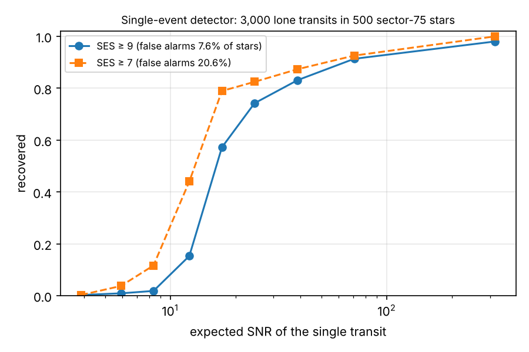
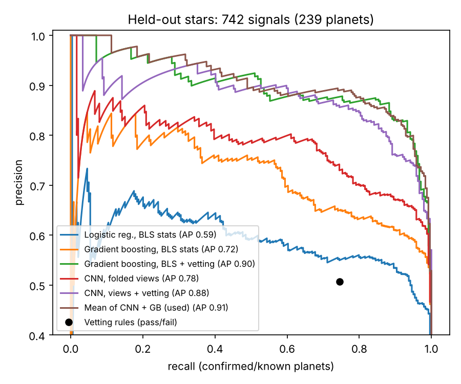
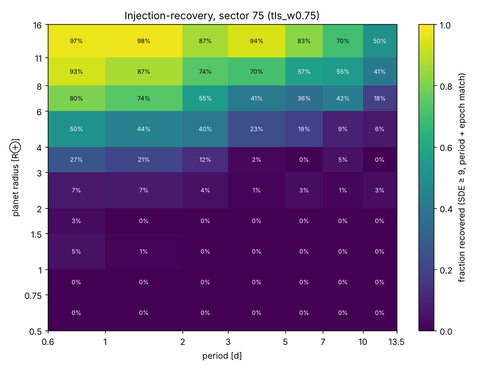
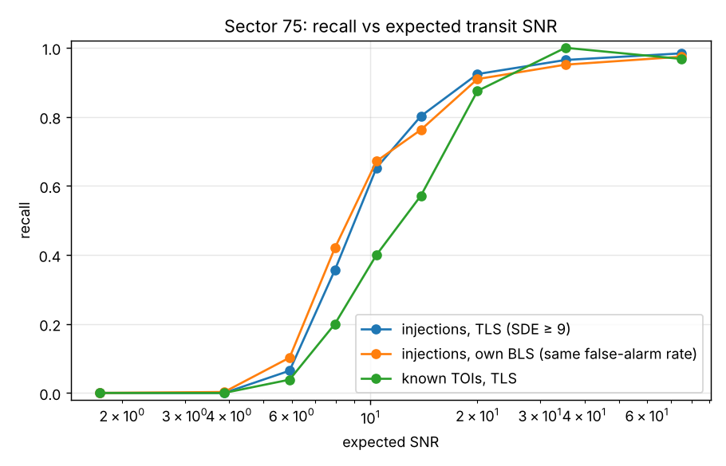

# exoplanet-hunt

An end-to-end transit search on NASA TESS light curves, written from scratch:
ingest, detrend, search, vet, classify. The goal is a pipeline whose accuracy is
**measured** (injection-recovery, known-planet recall, false-positive rate), then
pointed at sectors and stars that have had few independent searches.

Anything this pipeline flags is a *candidate*. Confirmation needs follow-up
observations by others.

## Status: week 4 (portfolio page)

[`site/`](site/) is a static page built from the results below: a WebGL sky map of
every star searched (16,238), a scroll-driven walkthrough of one star's real data
through all five stages, the injection-recovery heatmap with a found and a missed
example per cell, the scoreboard, and the 21 hand-vetted sector-105 signals with
their vetting sheets. Data comes from [`scripts/week4_export.py`](scripts/week4_export.py);
see [`site/README.md`](site/README.md) to run it or move it into another site.

## Sectors 90 to 104: M and K dwarfs

The full pipeline (detrend, periodic BLS, single-transit detector, vetting,
systematics filter, CNN + GBM classifier with the noise class) run on every
QLP M and K dwarf in sectors 90 to 104, with the same cuts as sector 105. It ran
on a laptop (Ryzen 7 7735HS, RTX 4050) in about 15 hours.

**Headline:** 252,054 stars searched → 126,513 signals → 2,774 that pass vetting
and the systematics filter → 652 at SNR ≥ 10 on stars with no TOI and no
period match to any CTOI or SPOC TCE → 51 top tier (63 sheets hand-vetted,
including some on CTOI/TCE hosts) → **8 new candidates** (2 periodic, 6 single
transits), plus weak ones. All of them are candidates, not planets.

| TIC | sector | kind | P (d) | depth | Rp (R⊕) | T | notes |
|---|---|---|---|---|---|---|---|
| 99412936 | 92 | periodic | 9.068 or 18.137 | 6,400 ppm | 7.3 | 11.4 | two clean flat-bottomed transits 18.14 d apart, middle epoch in the gap |
| 278708716 | 95 | periodic | 8.603 | 2,500 ppm | 4.5 | 11.6 | three transits, no odd/even or secondary |
| 402710280 | 102 | single | — | 1,500 ppm | 3.4 | 9.2 | clean 5 h transit on a bright K dwarf |
| 219413978 | 98 | single | — | 1.0% | 9 | 11.4 | clean 9 h flat-bottomed transit; a partial dip in sector 94 at a gap edge could be a second (P = 124.5/n d) |
| 307361219 | 96 | single | — | 2,800 ppm | 5.1 | 10.8 | clean 2.5 h dip |
| 124751008 | 98 | single | — | 3,000 ppm | 5.6 | 10.2 | clean, but TIC Teff and radius disagree |
| 293504894 | 97 | single | — | 1.7% | 10 | 11.9 | slightly V-shaped, EB as likely as a planet |
| 157843766 | 91 | single | — | 8,100 ppm | 12 | 11.5 | short and V-shaped, grazing EB likely |

Weak: TIC 122503688 (P = 17.28 d, 1,570 ppm), 428079143 (P = 4.258 d, 820 ppm,
T = 9.2), 241928959 (P = 3.53 d, M dwarf), 211380233 / 325791151 (single dips
with centroid shifts of about 4σ). Known, but possibly a new transit: TIC 67599025
(sector 104, 5,600 ppm single on a star with a WINE single-transit CTOI of the
same depth).

Everything else in the top tier was an eclipsing binary (often only visible
through a secondary eclipse at the same period), a star that already has a CTOI
or TCE at another period, scattered light, or QLP aperture switches.
Verdicts with reasons: [`results/multi/hand_vetting.csv`](results/multi/hand_vetting.csv);
sheets: [`results/multi/sheets/`](results/multi/sheets/); every candidate with all
vetting columns: [`results/multi/candidates.csv`](results/multi/candidates.csv);
per-sector numbers: [`results/multi/funnel_by_sector.csv`](results/multi/funnel_by_sector.csv)
and `results/s00NN/`.

**What this run taught**

* **"Periodic" deep signals are often one event.** BLS happily fits a period to a
  single deep eclipse when the other epochs fall in gaps; about a third of the
  periodic signals I hand-vetted were that. The classifier scores them high.
* **A period mismatch on a known host is usually the known signal.** Single
  events and 4× aliases (TIC 269593126 vs a SPOC TCE at 11.88 d) slip past the
  period cross-match, so the ranking now drops stars with any CTOI or TCE out of
  the top tier.
* **Secondary eclipses look like single transits.** TIC 259373684's two
  "single transits" in sectors 97 and 98 are the phase-0.71 secondary of a 43.4 d
  eccentric EB whose 3% primaries are in the same light curves. The next step is
  to check every single event against the star's other dips.
* **The Galactic bulge (sector 93) times out MAST.** `sector_sample.py` splits
  cones that fail into seven smaller ones.
* **The GPU doesn't matter end to end.** BLS is under 5% of the per-star time;
  downloading (about 5 files/s) and detrending dominate, so the run uses the CPU
  BLS on 10 processes. Light curves are streamed and deleted unless a signal
  passes vetting, so a sector never needs its 11 GB on disk.

Reproduce:

```bash
python scripts/fetch_catalogs.py 90 91 ... 104   # CTOIs, all SPOC TCE files, QLP target lists
python scripts/build_noise_set.py && python scripts/build_noise_set_mk.py   # classifier noise class
for s in 90 ... 104:
    python scripts/sector_sample.py $s           # M/K dwarf sample (reproduces sector 105's 15,511 exactly)
    python scripts/stream_hunt.py $s             # download + hunt, keeps only vetted light curves
    python scripts/week3_score.py $s             # systematics, classifier, cross-matches
python scripts/multi_rank.py 90 ... 105          # combined ranking + sheets
```

## Week 3: vet, classify, search a recent sector

Week 3 adds the last two pipeline stages (automatic vetting and a classifier),
a dedicated single-transit detector, and points the whole thing at **sector 105**
(observed mid-2026, the newest QLP sector on MAST, no TOIs from it yet).

**Headline:** on 15,511 M and K dwarfs in sector 105 the pipeline produced
8,693 signals; the systematics filter, vetting and classifier cut them to 21
unknown signals worth a look, and **hand-vetting rejected every one as a new
candidate.** The two strongest lone dips both landed on stars that already
host single-transit community TOIs, years after their first transit: a fair
check that the detector finds real things, and a new transit epoch for one of
them. No CTOI submission this week.

### Vetting (stage 4)

[`vetting.py`](src/exohunt/vetting.py) re-detrends each signal with its own
transits masked (so the filter never eats the dip being judged), masks the
star's *other* signals unless they are harmonics of this one (an eclipsing
binary's secondary is often found as a "second planet" at the same period),
and measures:

| check | catches | flag |
|---|---|---|
| odd vs even transit depth | eclipsing binary found at half its period | `oddeven` (> 3σ) |
| best dip elsewhere in phase, and at phase 0.5 | secondary eclipse | `secondary` (look-elsewhere corrected) |
| in-transit shift of the QLP flux centroid (`SAP_X/Y`) and the implied source offset | light from a neighbouring star | `centroid` (> 4σ and > 1 px) |
| transits within one duration of a reaction-wheel momentum dump (QUALITY bit 32) | pointing systematics | `dump` |
| one event carrying most of the SNR | outlier, not periodic | `oneevent` |
| implied radius from depth and TIC R★ | stellar companion | `toobig` (> 30 R⊕) |
| duration vs. the longest circular orbit allowed by TIC ρ★ | wrong star / giant / EB | `toolong` |
| scatter around the dip vs. the whole light curve | dip sits in a bad stretch | `noisy` (> 1.5×) |
| lone dip in the first day of a data segment | orbit-start ramps | `edge` |

Every check also returns its number (red-noise-corrected σ), which the
classifier uses as a feature. On the sector-75 detections that match known TOIs:

| group | n | flagged | odd/even | secondary | centroid |
|---|---|---|---|---|---|
| known false positives (FP) | 42 | **45%** | 19% | 10% | 19% |
| candidates (PC/APC) | 55 | 25% | 5% | 2% | 4% |
| confirmed / known planets (CP/KP) | 25 | **12%** | 0% | 4% | 4% |

The three flagged planets are a third planet of TOI-1339 posing as a secondary
(we only search two signals per star), a 3.6 px centroid shift on TOI-1174.01,
and one orbit-edge case. Most of the FPs that pass were ruled out by TFOP with
ground-based imaging and spectroscopy, at scales TESS's 21″ pixels cannot see.
Table: [`results/s0075/vetting_known.csv`](results/s0075/vetting_known.csv).

### Single-transit detector

[`search/single.py`](src/exohunt/search/single.py) slides boxes of 1 to 16 h
along the detrended light curve (a 2 d biweight for boxes over 4.5 h so long
transits survive) and scores each box by its depth over the robust scatter of
*all* box depths of that duration in the same star, which prices in red noise.
Periodic signals are masked first; each event is re-measured on a light curve
detrended with the event masked.



3,000 lone transits (P = 30 to 400 d, one transit in the data, 1.5 to 16 R⊕)
planted in the 500 week-2 field stars: **77% recovered at expected SNR 20 to 30,
91% above 50** with the SES ≥ 9 threshold, which 7.6% of un-injected stars also
cross (systematics, flares, variability). Recall holds up for long transits:
87% for 8 to 12 h, 73% above 12 h at SNR ≥ 15. On real data it finds **17 of the
54 sector-75 TOIs that show exactly one transit**, all the deep ones; the
misses are shallower than the noise allows, as for the periodic search.
Tables: [`single_events.csv`](results/s0075/injections/single_events.csv),
[`single_event_tois.csv`](results/s0075/single_event_tois.csv).

### Classifier (stage 5)

Training labels are every ExoFOP TOI with a TFOPWG disposition and T ≤ 13.5:
**2,578 signals**, 1,261 confirmed/known planets (CP/KP) vs 1,317 false
positives / false alarms (FP/FA), each from QLP light curves of its two most
recent sectors at the (re-centred) TOI ephemeris. The split is by host star
(70/10/20), so no star is on both sides. Inputs, after Shallue & Vanderburg
(2018):

* global view (201 bins over the orbit) and a local view (61 bins over ±2
  durations) with channels for all, odd and even transits, the strongest
  secondary dip, and centroid motion; [`views.py`](src/exohunt/views.py)
* 20 scalars: the BLS statistics plus the vetting numbers above and T, Teff, R★

The CNN ([`classify/model.py`](src/exohunt/classify/model.py)) is a two-tower
1-D conv net (global and local columns, 151k parameters), 5 seeds, trained in a
few minutes on CPU. The table is planet vs false positive on held-out stars
(502 TOIs); the models are also trained on a noise class, below.



| model | inputs | ROC AUC | avg. precision | precision / recall at 0.5 | recall at 90% precision |
|---|---|---|---|---|---|
| logistic regression | BLS stats (P, duration, depth, SNR, n transits) | 0.67 | 0.61 | 0.61 / 0.52 | 0% |
| gradient boosting | BLS stats | 0.78 | 0.72 | 0.68 / 0.67 | 0% |
| vetting rules | pass/fail flags | | | 0.53 / 0.74 | |
| CNN | folded views only | 0.84 | 0.78 | 0.71 / 0.78 | 2% |
| gradient boosting | BLS stats + vetting numbers | 0.93 | 0.90 | 0.84 / 0.89 | 53% |
| CNN | views + vetting numbers | 0.91 | 0.88 | 0.80 / 0.87 | 57% |
| **mean of the two above (used)** | | **0.93** | **0.91** | **0.83 / 0.90** | **49%** |

What this says: the folded light curve alone beats the plain BLS-statistics
baseline (AUC 0.85 vs 0.79), and the hand-built vetting numbers are worth as
much as the CNN's view of the light curve; the two together are best. The
strongest single features are implied radius, SNR, Teff and the duration ratio.
The pass/fail vetting rules are weak on TOIs (precision 0.53) because the easy
false positives never became TOIs; they matter more on raw detections.

**Noise class.** TOI labels teach planet vs astrophysical false positive, never
signal vs noise, so the first version gave SNR-6 noise on M dwarfs high scores.
Training now adds 1,249 "noise" signals: everything the full hunt reports on
2,069 stars with no TOI or CTOI (the 500 sector-75 field stars, 1,000 random
sector-103 targets, and 569 M/K dwarfs from sector 104 picked like the
sector-105 sample) ([`build_noise_set.py`](scripts/build_noise_set.py),
[`build_noise_set_mk.py`](scripts/build_noise_set_mk.py)). Planet vs false
positive is unchanged (AUC 0.93), planet vs noise on held-out stars is 0.999
([metrics](results/classifier/metrics_test_planet_vs_noise.csv)), and on
sector 105 the number of vetted SNR < 10 signals scoring ≥ 0.5 fell from
69 to 22. It does not fall to zero, and it cannot: many real TOI planets also
have single-sector QLP SNR of 5 to 8, so low SNR is not evidence of noise to a
classifier trained on them. The SNR ≥ 10 gate before hand-vetting stays; it
matches injection-recovery, where recall is under 40% below SNR 9 anyway.

### Sector 105: M and K dwarfs

Sample: every QLP sector-105 target classed as a dwarf with Teff < 3,900 K and
T ≤ 13.5 (**7,152 M dwarfs**) or 3,900 to 5,300 K and T ≤ 12 (**8,359 K
dwarfs**). Each star: biweight detrend, own BLS (up to 2 signals, SDE ≥ 6),
single-event search (SES ≥ 9), vetting, views, classifier. About an hour on
4 cloud cores ([`hunt.py`](src/exohunt/hunt.py), [`scripts/week3_hunt.py`](scripts/week3_hunt.py),
[`scripts/week3_score.py`](scripts/week3_score.py)).

| step | signals |
|---|---|
| detected (1,943 periodic + 6,750 single events) | 8,693 |
| sector-wide systematics: lone dips bunched in time across many stars (orbit starts, scattered light), or periods shared by ≥ 8 stars (6.59 d) | −7,800 |
| fail vetting | −3,368 (overlapping) |
| pass everything | 149 |
| … and not on a TOI host, not matching a TOI / CTOI / SPOC TCE period | 135 |
| … with SNR ≥ 10 → hand-vetted | **21** |

Sanity check on the 43 known TOIs (CP/KP/PC/APC) on sample stars: 19 are
recovered by period, with a median classifier score of 0.71 (14 of 19 score ≥ 0.5); the misses are
mostly long periods and depths near 1,000 ppm.

**Hand-vetting** ([sheets](results/s0105/sheets/), verdicts in
[`hand_vetting.csv`](results/s0105/hand_vetting.csv)):

| verdict | n | |
|---|---|---|
| known single-transit CTOI, new transit | 2 | TIC 7145074, TIC 409696823 |
| false positive: blend / eclipsing binary | 7 | incl. TIC 139526205 (below) |
| stellar variability | 4 | rotation / pulsation troughs |
| noise or systematics | 7 | outlier-driven folds, ramps, bad stretches |
| inconclusive, too weak for a CTOI | 1 | TIC 469933683 |

* **TIC 7145074**: a clean 5,200 ppm, 3.8 h lone transit at BTJD 4217.50.
  The star already hosts CTOI 7145074.01, a WINE single transit at BTJD 2111.52
  (4,000 ppm). If it is the same body, sector 105 caught a second transit
  2,106 d later, so P = 2,106 / n days. Worth passing to the CTOI owners.
* **TIC 409696823**: a 5,100 ppm, 1.7 h lone dip at BTJD 4215.21 on a star with
  a TSTPC single-transit CTOI (BTJD 3142.37, 10,700 ppm, 2.7 h). Depth and
  duration disagree, so it may not be the same object.
* **TIC 139526205** shows why the centroid check earns its place: the best
  periodic signal in the sector (P = 2.923 d, 4,700 ppm, SNR 44, "5.4 R⊕")
  moves the centroid by 22σ. QLP sectors 3 and 30 show the same period at
  5.7 to 6.4% depth with an odd/even difference and a > 1 px offset: an
  eclipsing binary next door, diluted in sector 105. The classifier gave it 0.03.

Duplicate checks run: ExoFOP TOI and CTOI tables (by TIC and period), SPOC TCE
catalogues on MAST (sector 105 and the sectors 1 to 96 multi-sector run). The
T16 and transformer-search (Salinas et al. 2025) tables, VizieR, the NASA
Exoplanet Archive and TEV are not reachable from this environment, so they were
not checked; none of the 21 needed it after hand-vetting. (T16 light curves
are on MAST as an HLSP, which makes a later cross-check possible.)

### What week 3 taught

* **Recent-sector data are rough.** Sector 105's second orbit is far noisier
  than its first for many stars, and both orbits start with ramps. 90% of all
  detections were sector-wide systematics, which only a cross-star filter
  (many stars dipping at the same time) removes; per-star vetting cannot.
* **An eclipsing binary's secondary looks like a second planet.** The first
  run masked "other signals" before vetting, which hid the secondary of every
  EB found twice. Never mask harmonics of the signal being vetted.
* **Training labels shape what a classifier can say.** TOI dispositions teach
  planet vs astrophysical false positive, not signal vs noise.

### Reproduce week 3

```bash
pip install -e .[dev,ml]
python scripts/fetch_week3_data.py      # s75 hosts + field stars, ~4,500 training light curves (~3 GB)
python scripts/build_training_set.py    # views + vetting features -> data/training/
python scripts/week3_train.py 5         # baselines + CNN ensembles -> results/classifier/
python scripts/week3_vet_s75.py         # vetting on known sector-75 signals
python scripts/week3_single_inject.py 6 # single-transit injections
python scripts/week3_single_tois.py     # single-transit TOIs in sector 75
python scripts/tic_params.py 105        # TIC parameters for the QLP sector-105 target list
python scripts/s105_targets.py          # pick + download the M/K dwarf sample (~11 GB)
python scripts/week3_hunt.py 105        # full pipeline (~1 h on 4 cores)
python scripts/week3_score.py 105       # systematics filter, classifier, cross-matches
python scripts/week3_sheets.py 105      # vetting sheets for the hand-vet list
```

## Week 2: measure it

Week 2 answers "how good is this pipeline, and why does it miss what it misses?"
with injection-recovery, recall on every known TOI in the sector, a
false-alarm rate, and a from-scratch BLS search with a CUDA kernel.

**Headline:** the pipeline is at the noise limit. It recovers **93% of injected
planets whose transits have an expected SNR ≥ 12** (50% at SNR ≈ 9.5), known
TOIs follow the same curve, and the shallow-planet misses from week 1 are
signals too faint for one sector of QLP data, not signals the pipeline throws away.

### Injection-recovery

5,000 synthetic planets planted in the **raw** QLP flux of 500 sector-75 stars
that host no TOI (T ≤ 13.5, R★ < 2.5 R☉, drawn from three RA strips; median
T = 12.7), then run through the full pipeline: detrend, TLS (2 signals/star),
cross-match. Transits are limb-darkened batman models integrated over the 200 s
exposure, with P log-uniform in 0.6 to 13.5 d, R_p log-uniform in 0.5 to 16 R⊕,
b uniform in 0 to 0.9, and each star's TIC radius and mass. "Recovered" means
SDE ≥ 9 and a period (or simple alias) and epoch match.



The radius map reflects these fairly faint field stars (a 2 R⊕ planet is
~350 ppm on a Sun-like star; one 200 s point at T = 12.7 scatters by ~5,000 ppm).
The number that transfers to any star is recall against **expected SNR**
(injected depth × √(in-transit points) / point scatter):



| expected SNR | 5–7 | 7–9 | 9–12 | 12–16 | 16–25 | 25–50 | > 50 |
|---|---|---|---|---|---|---|---|
| injections, TLS | 6% | 36% | 65% | 80% | 92% | 96% | 98% |
| known TOIs, TLS | 4% | 20% | 40% | 57% | 88% | 100% | 97% |

The TOI curve lags at SNR 9 to 16 because of long periods, not depth: of the 12
known TOIs with SNR ≥ 12 that were missed, 6 have P > 13.5 d, which the
periodic search (≥ 2 transits, P ≤ baseline/2) never tries, and one is the
strong-TTV system TOI-1136.01. Restricted to
P ≤ 13.5 d, known-TOI recall at SNR ≥ 12 is **91.5%** against 93% for
injections, which is a good check that the injections are realistic.

Tables: [`results/s0075/injections/`](results/s0075/injections/) (one row per
injection, with `snr_expected` and `depth_retained`), [`recall_vs_snr.csv`](results/s0075/recall_vs_snr.csv),
[`toi_expected_snr.csv`](results/s0075/toi_expected_snr.csv).

### Why the shallow planets were missed

* **Noise, mostly.** 87 of the 181 known TOIs with ≥ 2 transits in sector 75
  have an expected SNR below 9 in its QLP light curve; recall there is 7%,
  in line with the injections (0 to 36%). These need more sectors stacked
  (or 2-min SPOC data), not a different search.
* **Detrending eats a little, and only for long transits.** Depth kept after
  the 0.75 d biweight: 99% for transits under 2.5 h, 86% at 3.5 to 5 h, 75% at
  5 to 7 h, 60% above 7 h. Paired tests on the same 1,500 injections:

  | variant | recall | SNR 7–12 | SNR ≥ 12 | SNR ≥ 12, > 4 h | depth kept, > 4 h |
  |---|---|---|---|---|---|
  | biweight 0.5 d | 25.2% | 39% | 95% | 87% | 67% |
  | **biweight 0.75 d (default)** | **25.8%** | **47%** | **95%** | **87%** | 82% |
  | biweight 1.0 d | 25.1% | 45% | 93% | 79% | 89% |
  | biweight 1.5 d | 24.4% | 39% | 92% | 79% | 94% |
  | 0.75 d on QLP `SYS_RM_FLUX` | 24.9% | 42% | 94% | 83% | 80% |

  Longer windows keep more of a long dip but let more stellar variability
  through, which costs more than it gains. 0.75 d on raw SAP flux stays the default.
* **Long periods.** Allowing P up to the full baseline (one transit minimum in
  the grid) gained 1 TOI and lost 2 (lone dips outranked real signals), and a
  separate long-period pass on the masked light curve gained none. Long periods
  and single transits go to the dedicated single-event detector in week 3.
* **Data gaps.** 36 of the 79 high-SNR injection misses had only one transit
  in good data; no periodic search can get those.

### Recall on all known TOIs in sector 75

Every ExoFOP TOI in the sector, no magnitude cut (QLP has light curves for 298
of the 313 host stars). Over TOIs with ≥ 2 transits in the data:

| set | n | recovered (SDE ≥ 9) | recall |
|---|---|---|---|
| CP / KP / PC / APC, T ≤ 13.5 (week 1 sample) | 173 | 76 | 44% |
| CP / KP / PC / APC, all T | 181 | 79 | 44% |
| FP (known false positives) | 62 | 42 | 68% |

The pipeline also "finds" two thirds of the known false positives, mostly
eclipsing binaries with deep, easy dips. Telling those apart is the vetting and
classifier stages' job, and these 42 are a ready-made test set for them.

### False-alarm rate

Searching the same 500 field stars *without* injections, 2.8% get a top signal
with TLS SDE ≥ 9. Some of these are real (variables, eclipsing binaries,
perhaps planets), so this is an upper bound on the false-alarm rate.

### Own BLS search, CPU and CUDA

[`search/bls.py`](src/exohunt/search/bls.py) is a Box Least Squares written from
scratch: fold into phase bins, prefix-sum, score every box of 0.5 to 8 h with
Δχ² = s² / (r (1 − r)), SDE from the detrended periodogram, on the same Ofir
period grid TLS uses. It has two backends running the identical algorithm:

* **CPU:** numba, parallel over trial periods.
* **CUDA:** one thread block per (period, star). The block bins the star's
  points into shared memory with atomics, prefix-sums the bins cooperatively,
  each thread scores a slice of start phases, and a block reduction keeps the
  best box. Hundreds of stars go into a single launch.

**Accuracy at the same false-alarm rate** (BLS SDE ≥ 6.0 flags 2.2% of
un-injected stars vs 2.8% for TLS SDE ≥ 9), on the same 5,000 injections:
BLS recovers **26.2%** vs TLS **26.0%**: slightly better at SNR 5 to 9,
slightly worse above 12. TLS's limb-darkened template helps on strong signals,
the box costs little.

**Speed** (227 TOI hosts, median 11,205 points, 2,479 trial periods, search only):

| backend | hardware | stars / s | vs TLS |
|---|---|---|---|
| TLS (reference) | 4-core cloud VM | 5.9 | 1× |
| own BLS, numba | 4-core cloud VM | 23.7 | 4.0× |
| TLS (reference) | laptop, 16 threads | 3.6 | 1× |
| own BLS, numba | laptop, 16 threads | 52.0 | 14× |
| **own BLS, CUDA** | **RTX 4050 Laptop GPU** | **148** | **41×** |

On the same laptop the CUDA kernel is 2.9× faster than the numba CPU BLS and
returns the same best periods (both agree with TLS on 69% of stars; TLS uses a
different, limb-darkened statistic). Throughput is the same for 100 and 227
stars (149 vs 148 stars/s), so launch and copy overhead are negligible and
the kernel is compute-bound. Reading and detrending now cost more than the GPU
search (~44 stars/s on one core), so parallelising that step is the next speed-up,
not a C++ rewrite: numba already compiles the kernel to the same PTX/SASS nvcc would.
The kernel-vs-CPU test also passes on the real device (`EXOHUNT_REAL_CUDA=1`).
Raw numbers: [`benchmark_cpu4.csv`](results/s0075/benchmark_cpu4.csv), [`benchmark_gpu.csv`](results/s0075/benchmark_gpu.csv).

To reproduce on a machine with an NVIDIA GPU:

```bash
pip install -e .[dev,gpu]                 # adds numba-cuda (CUDA 12)
exohunt ingest --sector 75                # ~155 MB
EXOHUNT_REAL_CUDA=1 pytest tests/test_bls.py   # kernel vs CPU on the real device
exohunt bench --sector 75 --n 227 --tag gpu    # TLS vs BLS CPU vs BLS CUDA -> results/s0075/benchmark_gpu.csv
```

## Week 1: rediscover known planets

Sector 75 (2024), QLP full-frame-image light curves, every ExoFOP TOI host with
TFOPWG disposition CP / KP / PC / APC and T ≤ 13.5: **250 TOIs on 227 stars**.

| step | what it does |
|---|---|
| ingest | QLP `SAP_FLUX` from MAST; drop cadences with `QUALITY != 0`; normalise |
| detrend | wotan sliding biweight, 0.75 d window; clip upward outliers only |
| search | Transit Least Squares, P = 0.6 d to baseline/2, up to 2 signals per star (mask and repeat) |
| cross-match | detected period vs TOI period (incl. 1/2, 2, 1/3, 3, 3/2, 2/3 aliases), TOI ephemeris propagated to our epoch |

**Runtime:** about 75 s for all 227 stars on 4 CPU cores (≈0.3 s per star-signal).

### Recall on known TOIs (week 1)

Only TOIs with **at least 2 transits inside the sector's good data** can be found by
a periodic search, so recall is computed over those 173 (the other 77 have 0 or 1
transit in this sector; that is the single-event detector's job in week 3).

| TFOPWG disposition | n | recovered, SDE ≥ 9 | recall | recovered, SDE ≥ 7 | recall |
|---|---|---|---|---|---|
| CP (confirmed) | 33 | 14 | 42% | 17 | 52% |
| KP (known planet) | 17 | 9 | 53% | 9 | 53% |
| APC | 18 | 15 | 83% | 15 | 83% |
| PC | 105 | 38 | 36% | 44 | 42% |
| **all** | **173** | **76** | **44%** | **85** | **49%** |

"Recovered" = exact period match or a simple alias, with transits landing on the
TOI ephemeris. One more (TOI-1136.01, a strong-TTV system) matches in period but
its transits are offset by ~6 h from the linear ephemeris, so it is not counted.

Recall by TOI depth (SDE ≥ 9):

| depth | n | recall |
|---|---|---|
| < 500 ppm | 25 | 8% |
| 500 – 1000 ppm | 32 | 28% |
| 1000 – 3000 ppm | 49 | 37% |
| > 3000 ppm | 67 | 70% |

Smallest planets recovered: TOI-4481.01 (1.7 R⊕, 950 ppm, P = 0.93 d),
TOI-1430.01 (2.0 R⊕, 700 ppm, P = 7.43 d), TOI-1339.01 (3.2 R⊕, P = 8.88 d).

Full tables: [`results/s0075/`](results/s0075/) (`detections.csv`, `recovery_sde9.csv`, `recall_summary_sde9.csv`).


### What week 1 taught

* **QLP v02 files** (later sectors) rename `KSPSAP_FLUX` to `DET_FLUX`; the reader handles both.
* **Data gaps create 3/2 aliases.** TOI-1148.01 (P = 5.55 d) shows only two transits
  16.65 d apart, so TLS picks 8.33 d. TLS's reported T0 can also sit inside a gap,
  so the cross-match checks several detected epochs, not just T0.
* **Stellar-density period grids cut both ways.** Using each star's TIC radius and
  mass lets TLS search below 0.6 d (it recovered the 0.41 d TOI-1442.01) but the
  denser grid lowered SDEs elsewhere and lost six other recoveries, so the default
  stays solar (`use_stellar_params=False`). Week 2's injection
  tests will settle the grid properly.
* **Shallow signals are the gap.** Recall falls below 30% under 1000 ppm. That,
  plus single transits and long periods, is what injection-recovery has to map.

## Usage

```bash
pip install -e .[dev]
exohunt ingest --sector 75          # TOI hosts in the sector -> data/lightcurves/s0075
exohunt search --sector 75          # detrend + TLS -> results/s0075/detections.csv (resumable)
exohunt report --sector 75 --min-sde 9
exohunt plot   --sector 75 --tic 239332587
exohunt inject --sector 75 --n-per-star 10 --tag tls_w0.75   # injection-recovery (needs the field-star list below)
exohunt bench  --sector 75 --n 227                           # search speed
python scripts/week2_summary.py     # rebuild week-2 figures and tables
pytest                              # synthetic transits through TLS and BLS; CUDA kernel vs CPU (simulator)
```

`EXOHUNT_DATA` overrides the data directory (default `./data`, git-ignored).

Injection hosts: `catalog.qlp_field_stars(75)` lists QLP targets in three RA
strips with TIC parameters; the 500 used here (T ≤ 13.5, R★ < 2.5 R☉, no TOI,
`random_state=75`) are downloaded into `data/lightcurves/s0075_field/`.

## Layout

```
src/exohunt/
  catalog.py     ExoFOP TOI table, per-sector targets, expected transit counts
  ingest.py      QLP download (URL from TIC id), quality mask, stitching
  detrend.py     wotan biweight
  search/        Detection type, iterative masking, TLS, own BLS (numba CPU + CUDA kernel)
  injection.py   synthetic transits into raw flux, campaigns, heatmaps, expected SNR
  bench.py       stars/s for TLS vs BLS CPU vs BLS CUDA
  crossmatch.py  period/epoch matching with aliases
  pipeline.py    parallel per-sector runner
  plots.py       raw -> detrended -> periodogram -> folded figure; vetting sheets
  vetting.py     masked detrend + odd/even, secondary, centroid, dumps, shape, edges
  views.py       global / local folded views, ephemeris re-centring
  labels.py      ExoFOP-labelled TOIs, star-level split, training downloads
  classify/      scalar features, two-tower CNN, ensembles
  search/single.py  single-event (lone transit) detector
  hunt.py        full per-star pipeline: detrend, BLS, single events, vetting, views
```

## Plan

1. ~~Week 1: rediscover known planets on one sector (CPU TLS)~~
2. ~~Week 2: injection-recovery harness, known-TOI recall, own BLS with CUDA kernel (41× TLS on an RTX 4050)~~ (vetting moves to week 3)
3. ~~Week 3: vetting, CNN on ExoFOP dispositions (AUC 0.935 vs 0.79 for BLS stats), single-transit detector, sector 105 search (no new candidate)~~
4. Week 4: portfolio page and any CTOI submission

## Data credits

TESS QLP light curves (Huang et al. 2020; Kunimoto et al. 2022) via MAST.
TOI catalogue from ExoFOP-TESS. Transit Least Squares (Hippke & Heller 2019),
wotan (Hippke et al. 2019), batman (Kreidberg 2015), BLS (Kovács et al. 2002),
period grid after Ofir (2014).
